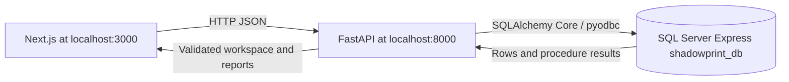

# SHADOWPRINT: Explainable Investigation with SQL Server

Academic report source — 6 November 2026. Add the student's name, institution, course and supervisor in the institution's submission template. No institutional approval or original research claim is implied.

## Abstract

SHADOWPRINT is a local academic application for examining synthetic account activity through relational queries and traceable evidence. A Next.js interface communicates with a FastAPI service that queries Microsoft SQL Server Express using Windows Authentication. Its 22-table schema separates source records, supplied annotations, rule definitions, detection runs, evidence, investigation cases and review history. Four explainable rules demonstrate repetition, repeated targeting, coordinated timing and threat-related annotations. The original nine-account, 28-comment scenario produces 11 findings with known positive examples and benign shared-device controls. The work demonstrates database normalization, constraints, advanced SQL, transactional updates and frontend persistence. It does not establish real-world detection accuracy, identity attribution or intent.

## Problem and objectives

An isolated dashboard can show suspicious-looking numbers without revealing their source. This project instead connects each signal to original synthetic records and records reviewer decisions separately. The objectives are to preserve provenance, implement normalized relationships, demonstrate substantive T-SQL, support a complete investigation workflow and verify correctness with deterministic controls.

The project runs on one Windows machine. Cloud signup, hosting, paid resources and public deployment are outside the agreed scope. All monitored accounts and comments are synthetic. Public-dataset provenance is supported in the schema, but no public dataset has been imported.

## Architecture and implementation

The API connects to `favipie\SQLEXPRESS` through ODBC Driver 18 with Windows Authentication. No database password is embedded in frontend code. Source queries use parameterized SQLAlchemy Core rather than an ORM that creates a competing schema. Startup does not create tables or reseed data. Existing fixtures remain available to regression tests, while the real home page uses the SQL provider and exposes connection failures instead of silently substituting fixtures.

The dashboard and seven screens share one SQL-backed workspace. Account investigation, threats, network exploration, coordination, case management, reports and settings refer to the same account/comment/evidence identifiers. Reviews, cases and notes persist through the API and are refreshed from the database after successful writes. SQL rules are read-only in settings. Reports support CSV and printable HTML; PDF output uses the browser's print function.

## Relational design

| Group | Tables | Purpose |
|---|---|---|
| Lineage and activity | provenance, accounts, posts, comments, devices, login_events, interactions | Preserve original records and observed activity |
| Annotations | label_types, comment_labels | Separate source annotations from computed findings |
| Detection | detection_rules, detection_runs, findings | Versioned rules, execution history and anchored windows |
| Evidence | evidence, finding_evidence | Reference typed original records and many-to-many finding support |
| Case workflow | investigators, investigations, investigation_accounts, investigation_evidence, investigation_findings, case_notes | Associate reviewers, accounts, evidence, findings and notes |
| Review history | review_actions, audit_history | Append review decisions and operational change snapshots |

The model targets third normal form. Repeating account/device and case/evidence arrays become rows with foreign keys. Composite keys prevent duplicate associations. Rule parameters depend on the rule code/version, and provenance metadata depends on its provenance ID. Display totals and scores are derived rather than duplicated as mutable counters.

Evidence references exactly one comment, login or interaction through nullable foreign keys and a CHECK constraint. Filtered unique indexes prevent repeated references to the same non-NULL source while allowing other source types. Closed/resolved cases require a nonblank decision. Audit JSON preserves historical before/after snapshots; it is not a replacement for relational links. Direct DML outside the application/procedures is not automatically audited.

The original frontend had no post IDs, so nine synthetic target-owned posts supply relational scaffolding. These posts have separate provenance; their existence is an implementation assumption, not recovered evidence. See the [SQL Server dictionary](../database/sqlserver/DATA-DICTIONARY.md), [ER relationships](../database/ER.md) and [normalization explanation](../database/NORMALIZATION.md).

## Explainable SQL rules

| Rule | Qualifying evidence | Inclusive window | Weight per account |
|---|---|---|---:|
| REP-01 | At least five comments by one author with the same normalized text | Anchor through anchor + 1,800 seconds | 25 |
| TARGET-01 | At least six supplied harassment-labeled comments by one author to one target | Anchor through anchor + 86,400 seconds | 25 |
| COORD-01 | At least three distinct authors with matching normalized text and target | Anchor through anchor + 90 seconds | 30 |
| THREAT-01 | A supplied threat-related annotation | Individual labeled comment | 20 |

Normalization lowercases text and collapses recognized whitespace; it does not perform semantic similarity or machine learning. Windows use timestamp comparisons with DATEADD and inclusive BETWEEN, not rounded time buckets. The coordination rule includes a participant exactly 90 seconds after the anchor and excludes one at 91 seconds.

Each qualifying anchor can produce a finding. The score counts each rule once per account, avoiding repeated points for overlapping windows. `v_account_scores` evaluates current source evidence; saved findings preserve a detection run. If source data were edited directly, current scores and the latest saved run could differ until detection is rerun. Normal runtime permissions do not require source account/comment writes.

Shared-device observations are contextual edges only. They neither establish common identity nor contribute score. Threat labels are supplied annotations, not predictions or proof of danger. These distinctions are essential to interpreting the demonstration correctly.

## Advanced SQL and transactions

The executable [academic examples](../database/sqlserver/005_academic_queries.sql) demonstrate JOINs for provenance, a login self-join for device context, GROUP BY/HAVING for volume, a correlated NOT EXISTS subquery, an aggregate CTE, a recursive interaction-path CTE with cycle/depth guards, ROW_NUMBER and LAG, views, indexed predicates and an explicit rollback demonstration. The file includes an UPDATE followed by ROLLBACK; it is not a read-only script. Use a disposable database for demonstrations that execute writes.

`run_detection`, `review_comment` and `change_case_status` use TRY/CATCH, XACT_ABORT and rollback on failure. They own their transactions and reject caller transactions, so the API invokes them through autocommit connections. Detection materializes matches once before creating findings and evidence associations. Case creation, metadata/evidence changes and notes use application transactions that include audit entries. Status and metadata are separate audited operations; the UI reports partial failure rather than claiming atomicity across both.

Indexes support author/time, target/time, device/time, post/time and latest-review lookup. Their existence is not a benchmark: large-workload performance and query-plan measurements remain pending. Serializable read transactions provide consistent small-workspace reads but can block concurrent writers; this is a local-project tradeoff.

## Dataset and evaluation

The preserved baseline contains nine accounts, 28 comments, 25 annotations, six devices, eight login events and three investigations. It produces 11 findings, 53 finding-evidence associations and 24 distinct detection-evidence comments. These are different measurements and must not be presented interchangeably.

| Account | Baseline score |
|---|---:|
| A-001 | 30 |
| A-002 | 55 |
| A-003 | 50 |
| A-004 | 25 |
| A-006 | 25 |
| A-005, A-007, A-008, U-021 | 0 |

The SQL Server workload generator adds deterministic, explicitly synthetic accounts, unique harmless comments, repeated promotion, targeting, threat-label and coordination scenarios. Its SQL rejects the main database and requires a disposable test-database naming pattern. It is an additive experiment, not a replacement seed. See the [local verification checkpoint](LOCAL-VERIFICATION.md) for the exact executed dataset size and results; the supported maximum input is not a tested scalability claim.

Prior Phase 4–5 verification recorded 11 passing backend tests, 26 frontend/artifact tests, three browser tests and a passing production build. The browser workflow covered investigation → evidence → case → note → review → reload → report. Mobile screenshots and a one-page printed sample were visually checked. These are engineering checks against authored scenarios, not a statistical evaluation of real cybercrime or harassment detection. No accuracy, precision or recall percentage is claimed.

## Limitations and conclusion

The fixed local reviewer is not an authenticated identity. A custom header and CORS provide request guards, not login or authorization. Audit rows are not tamper-proof against database administrators. Current graph/screen data uses a bounded snapshot, large import/paging benchmarks are pending, and case edits have last-write-wins semantics. Findings are explainable review signals, never identity or intent conclusions.

SHADOWPRINT demonstrates a complete local relational investigation workflow with traceable data, constraints, SQL analytics, audited persistence and tested interface integration. Its academic contribution is the reproducible implementation and explicit treatment of uncertainty, rather than a claim of production readiness or learned detection capability.

## Reproducible implementation references

- [Authoritative T-SQL schema](../database/sqlserver/001_schema.sql), [views](../database/sqlserver/002_views.sql), [procedures](../database/sqlserver/003_procedures.sql) and [original seed](../database/sqlserver/004_seed.sql).
- [SQL Server execution report](../database/sqlserver/VALIDATION.md) and [Phase 4–5 execution report](../backend/PHASE45-REPORT.md).
- [FastAPI endpoint and test instructions](../backend/README.md), [Windows setup](../SETUP-WINDOWS.md) and [demo walkthrough](DEMO-WALKTHROUGH.md).

These references identify the implementation and execution evidence. Add any institution-required external literature review and citation style separately; no unreviewed bibliography is fabricated here.
