# Entity relationships

Every line below is backed by an actual foreign key in 001_schema.sql. Junction tables implement many-to-many associations. Device connections are observations, not identities.

```mermaid
erDiagram
    provenance {
        varchar id "First key column; full definition in dictionary"
    }
    accounts {
        varchar id "First key column; full definition in dictionary"
    }
    provenance ||--o{ accounts : "provenance_id"
    posts {
        varchar id "First key column; full definition in dictionary"
    }
    accounts ||--o{ posts : "author_id"
    provenance ||--o{ posts : "provenance_id"
    comments {
        varchar id "First key column; full definition in dictionary"
    }
    accounts ||--o{ comments : "author_id"
    accounts ||--o{ comments : "target_id"
    posts ||--o{ comments : "post_id"
    provenance ||--o{ comments : "provenance_id"
    devices {
        varchar id "First key column; full definition in dictionary"
    }
    provenance ||--o{ devices : "provenance_id"
    login_events {
        varchar id "First key column; full definition in dictionary"
    }
    accounts ||--o{ login_events : "account_id"
    devices ||--o{ login_events : "device_id"
    provenance ||--o{ login_events : "provenance_id"
    interactions {
        varchar id "First key column; full definition in dictionary"
    }
    accounts ||--o{ interactions : "actor_id"
    posts ||--o{ interactions : "post_id"
    provenance ||--o{ interactions : "provenance_id"
    label_types {
        varchar code "First key column; full definition in dictionary"
    }
    comment_labels {
        varchar comment_id "First key column; full definition in dictionary"
    }
    comments ||--o{ comment_labels : "comment_id"
    label_types ||--o{ comment_labels : "label_code"
    provenance ||--o{ comment_labels : "provenance_id"
    detection_rules {
        varchar code "First key column; full definition in dictionary"
    }
    detection_runs {
        varchar id "First key column; full definition in dictionary"
    }
    findings {
        varchar id "First key column; full definition in dictionary"
    }
    detection_runs ||--o{ findings : "run_id"
    detection_rules ||--o{ findings : "rule_code,rule_version"
    accounts ||--o{ findings : "account_id"
    comments ||--o{ findings : "anchor_comment_id"
    evidence {
        varchar id "First key column; full definition in dictionary"
    }
    comments ||--o{ evidence : "comment_id"
    login_events ||--o{ evidence : "login_id"
    interactions ||--o{ evidence : "interaction_id"
    finding_evidence {
        varchar finding_id "First key column; full definition in dictionary"
    }
    findings ||--o{ finding_evidence : "finding_id"
    evidence ||--o{ finding_evidence : "evidence_id"
    investigators {
        varchar id "First key column; full definition in dictionary"
    }
    investigations {
        varchar id "First key column; full definition in dictionary"
    }
    investigation_accounts {
        varchar investigation_id "First key column; full definition in dictionary"
    }
    investigations ||--o{ investigation_accounts : "investigation_id"
    accounts ||--o{ investigation_accounts : "account_id"
    investigation_evidence {
        varchar investigation_id "First key column; full definition in dictionary"
    }
    investigations ||--o{ investigation_evidence : "investigation_id"
    evidence ||--o{ investigation_evidence : "evidence_id"
    investigation_findings {
        varchar investigation_id "First key column; full definition in dictionary"
    }
    investigations ||--o{ investigation_findings : "investigation_id"
    findings ||--o{ investigation_findings : "finding_id"
    case_notes {
        varchar id "First key column; full definition in dictionary"
    }
    investigations ||--o{ case_notes : "investigation_id"
    investigators ||--o{ case_notes : "investigator_id"
    review_actions {
        bigint id "First key column; full definition in dictionary"
    }
    comments ||--o{ review_actions : "comment_id"
    investigators ||--o{ review_actions : "investigator_id"
    audit_history {
        bigint id "First key column; full definition in dictionary"
    }
    investigators ||--o{ audit_history : "investigator_id"
    investigations ||--o{ audit_history : "investigation_id"
    review_actions ||--o{ audit_history : "review_action_id"
```

The optional evidence source keys use a CHECK enforcing exactly one source. Optional audit targets likewise require exactly one case or review action. Mermaid shows the general parent-to-child relationship; consult field nullability for optional edges.
